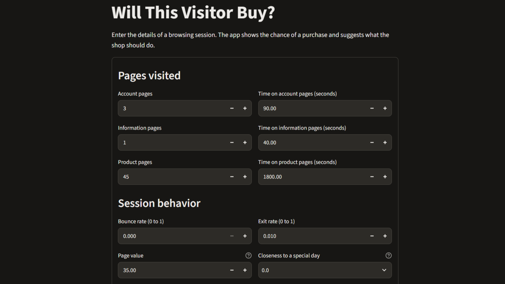
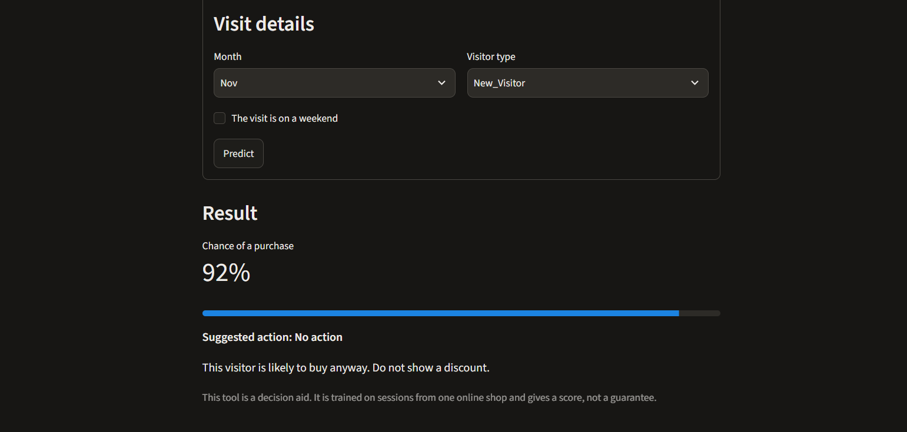

# Will This Visitor Buy?

Most visitors of an online shop leave without buying, so this project predicts from a browsing session if the visitor will buy, and suggests when to show a coupon or a chat assistant.

**Live app:** https://purchase-intent-app-r89nhl5mvbm2hajcjdcrzw.streamlit.app/





## Results

Scores on a test set that was not used for training or tuning (20% of the data).

| Model | Accuracy | Precision | Recall | F1 | ROC-AUC |
|---|---|---|---|---|---|
| Baseline (always "no purchase") | 0.844 | 0.000 | 0.000 | 0.000 | 0.500 |
| Best Model: Random Forest | 0.895 | 0.648 | 0.717 | 0.681 | 0.929 |

- The baseline looks good on accuracy but never finds a buyer (recall 0).
- The best model finds 72% of the real buyers and is right 	65% of the time when it predicts a purchase.
- The most important columns are PageValues, Month and Administrative.

## What the app does

You enter the details of one browsing session (pages visited, time spent, bounce and exit rates, page value, month, visitor type). The app returns the chance of a purchase and one suggested action:

| Chance of a purchase | Action | Why |
|---|---|---|
| High | No action | The visitor will likely buy anyway, so a discount is wasted |
| Middle | Show coupon | The visitor is undecided |
| Low | Show chat assistant | The visitor is unlikely to buy, and a chat costs less than a discount |

The cut-off between the groups comes from the threshold chosen in the notebook (0.65).

## How I built it

1. Defined the problem and the metric. Only about 15% of sessions end in a purchase, so I used ROC-AUC, recall and F1 and not accuracy alone.
2. Checked and explored the data, and wrote down the main insights.
3. Cleaned the data and built one scikit-learn pipeline (features, imputing, scaling, encoding). The data was split before any fitting, to avoid leakage.
4. Compared a baseline with Logistic Regression, Random Forest and Gradient Boosting using 5-fold cross-validation.
5. Tuned the models with grid search on the training data only, and chose the threshold with cross-validated predictions.
6. Evaluated on the test set with a confusion matrix, ROC curve and error analysis.
7. Saved the pipeline with joblib and built the app with Streamlit.

## Project files

| File | Description |
|---|---|
| `Purchase_Intent_Notebook.ipynb` | Full analysis, from data understanding to the saved model |
| `helpers.py` | Feature step and action rule, used by the notebook and the app |
| `app.py` | Streamlit web app |
| `purchase_model.joblib` | Saved pipeline |
| `threshold.json` | Saved threshold |
| `requirements.txt` | Packages for the app |

## How to run

1. Clone the repository:
   ```
   git clone https://github.com/KevinHany2111/Purchase-Intent-App.git
   cd Purchase-Intent-App
   ```
2. Create and activate a virtual environment, then install the packages:
   ```
   python -m venv venv
   venv\Scripts\activate
   pip install -r requirements.txt
   ```
3. Download the dataset (link below) and put `online_shoppers_intention.csv` in the project folder. The dataset is not included in this repository.
4. Open the notebook and run all cells. This trains the models and creates `purchase_model.joblib` and `threshold.json`. You can skip this step because the saved files are already in the repository.
5. Start the app:
   ```
   python -m streamlit run app.py
   ```

## Dataset

Online Shoppers Purchasing Intention, UCI Machine Learning Repository: https://archive.ics.uci.edu/dataset/468

About 12,000 sessions from one online shop over one year. Each row is one session, and the target is whether the session ended with a purchase.

## Limitations

- The data comes from one shop, so the model may not work as well for another shop.
- `PageValues` is calculated by the shop's analytics and must be available in real time.
- The model shows who looks like a buyer. It does not prove that a coupon makes them buy, so the coupon rule should be tested with an A/B test first.
- Some models use class weights, so the probabilities are best used as a score and not as exact chances.


Built as the final project of the NextGen Institute AI training.
